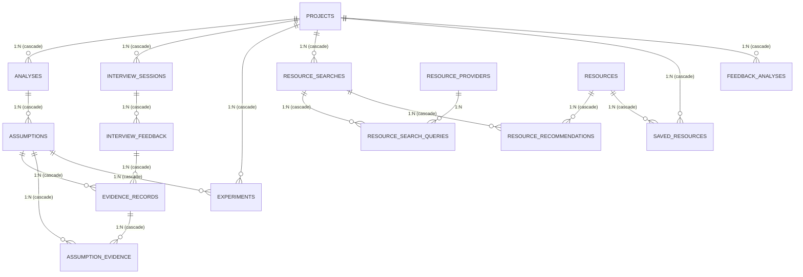
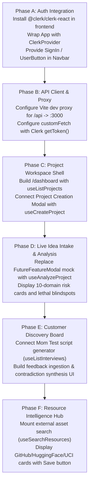

# Blindspot AI — Backend Audit & Application Integration Plan

**Audit Date:** 2026-11-07  
**Auditor:** Senior Full-Stack Architect & Backend Integration Engineer  
**Repository:** [https://github.com/Antrikshcodes/blindspot-ai](https://github.com/Antrikshcodes/blindspot-ai)  
**Target Document:** `docs/FRONTEND_INTEGRATION_AUDIT.md`  

---

## 1. Executive Summary

This audit evaluates the actual, verified implementation state of the **Blindspot AI** backend repository across source files, routes, database schemas, services, tests, configuration, and frontend assets.

### Key Audit Findings

1. **Backend Implementation Exists and is Substantial**:
   Contrary to a simple placeholder, the repository contains a fully written Express and TypeScript backend located in `backend/src/phase01/` with 32 live API endpoints, comprehensive Drizzle ORM schema definitions (15 PostgreSQL tables in the `blindspot_phase01` schema), live external resource providers (GitHub, Hugging Face, UCI, APIs.guru), deterministic 2D risk calculations, and OpenAI/Replit structured output generation.
2. **Two Backend Iterations Exist in Parallel**:
   - `backend/src/phase01/`: The primary, production-grade backend implementing the full validation protocol, Clerk authentication, Drizzle ORM, and rate limiting.
   - `backend/src/server.ts` & `backend/src/app.ts`: A legacy/early prototype backend using Prisma (`@prisma/client`), mounting only health check routes and a prototype Library API (which intentionally returns `503 LIBRARY_AUTH_NOT_READY` in production).
3. **Authentication is Clerk-Managed (No Local User Table)**:
   User authentication is handled strictly via **Clerk** (`@clerk/express`, `@clerk/shared`). There is **no local password database**, no local JWT generator, and no `users` table. The backend checks Clerk session cookies and Bearer tokens, mapping the verified subject ID (`auth.userId`) to `projects.ownerId`. If Clerk keys are missing from `.env`, the backend fails closed with `503 AUTH_NOT_READY`.
4. **Shared Types & Generated Client Exist**:
   - `lib/api-spec/openapi.yaml`: Complete OpenAPI 3.1.0 browser contract (2,474 lines).
   - `lib/api-client-react/`: Orval-generated TanStack React Query hooks and custom `fetch` wrapper.
   - `shared/types/index.ts`: TypeScript data contracts for projects, assumptions, interviews, contradictions, and experiments.
5. **Frontend State & Integration Gap**:
   The active frontend in `frontend/` (React 19 + Vite 6 + Tailwind CSS v4 + Framer Motion v12) has a polished landing page, brand system, and interactive hero, but currently uses mock in-memory data for `FutureFeatureModal`. It is not yet connected to the backend API or Clerk authentication.

---

## 2. Actual Technology Stack

| Layer | Declared Technology | Actual Verified Version / Package | Location in Repo |
| :--- | :--- | :--- | :--- |
| **Backend Runtime** | Node.js / Express | `express@4.21.2`, TypeScript `5.7.3`, `tsx@4.19.3` | `backend/src/phase01/` |
| **Database ORM** | Drizzle ORM | `drizzle-orm@0.45.4`, `pg@8.23.1`, `drizzle-kit@0.31.11` | `backend/src/phase01/db/` |
| **Legacy Database** | Prisma | `@prisma/client@6.4.0` (Prototype server only) | `backend/src/config/database.ts` |
| **Authentication** | Clerk | `@clerk/express@2.1.88`, `@clerk/shared@4.44.1` | `backend/src/phase01/auth.ts` |
| **AI Provider** | OpenAI / Replit | `openai@7.53.0` (`zodResponseFormat`) | `backend/src/phase01/ai/` |
| **Logging** | Pino | `pino@10.4.0`, `pino-http@11.0.0` | `backend/src/phase01/config.ts` |
| **Security & Limits** | Helmet & Rate Limit | `helmet@8.3.0`, `express-rate-limit@8.7.3` | `backend/src/phase01/app.ts` |
| **Validation** | Zod | `zod@4.6.7` (backend), `zod@3.25.76` (workspace) | `backend/src/phase01/contracts.ts` |
| **API Contract** | OpenAPI 3.1.0 | Specification in YAML | `lib/api-spec/openapi.yaml` |
| **API Client SDK** | Orval / React Query | `@tanstack/react-query@5.90.21` (generated) | `lib/api-client-react/` |
| **Active Frontend** | React / Vite | React `19.0.0`, Vite `6.2.0`, Tailwind `v4.0.9`, Motion `12.4.7` | `frontend/` |

---

## 3. Repository Structure

```
blindspot-ai/
├── backend/                              # Express & Drizzle Backend
│   ├── package.json                      # Dependencies: clerk, drizzle, openai, pino, pg
│   ├── tsconfig.phase01.json             # Production TypeScript configuration
│   ├── drizzle.config.ts                 # Drizzle schema & migration configuration
│   ├── src/
│   │   ├── phase01/                      # Primary Backend Implementation
│   │   │   ├── server.ts                 # Main server listener & graceful shutdown
│   │   │   ├── app.ts                    # Express app mounting all 32 API routes
│   │   │   ├── auth.ts                   # Clerk middleware & origin enforcement
│   │   │   ├── config.ts                 # Environment variable parsing & log redactor
│   │   │   ├── contracts.ts              # Zod input/output validation schemas
│   │   │   ├── ai/                       # LLM provider (OpenAI, Replit, Disabled)
│   │   │   ├── analysis/                 # 6-stage Idea Analysis Engine
│   │   │   ├── validation/               # ValidationService (assumptions, interviews, experiments)
│   │   │   ├── resource-intelligence/    # GitHub, Hugging Face, UCI, APIs.guru providers
│   │   │   └── db/
│   │   │       ├── schema.ts             # 15 Drizzle tables in blindspot_phase01 schema
│   │   │       ├── client.ts             # pg.Pool connection manager
│   │   │       └── migrations/           # SQL migration files (0000 - 0004)
│   │   ├── app.ts                        # Legacy prototype app (Prisma)
│   │   ├── server.ts                     # Legacy prototype server
│   │   └── modules/                      # Legacy health & library routes
│   └── tests/phase01/                    # Vitest integration test suites
│
├── frontend/                             # Active Vite + React 19 Frontend
│   ├── index.html                        # SEO metadata, Open Graph, fonts
│   ├── package.json                      # React 19, Tailwind v4, Framer Motion
│   └── src/
│       ├── App.tsx                       # Main shell with intro orchestration
│       ├── components/
│       │   ├── intro/IntroOverlay.tsx    # 3-second skippable cinematic intro
│       │   ├── layout/Navbar.tsx         # Scroll-spy navigation with sliding indicator
│       │   ├── layout/Footer.tsx         # Brand footer
│       │   ├── common/TiltCard.tsx       # Zero-rerender 3D tilt component
│       │   ├── common/InteractiveBackground.tsx # Engineering reticle grid & parallax
│       │   ├── sections/Hero.tsx         # Hero with Blindspot Reveal Engine
│       │   ├── sections/TheProblem.tsx   # 3 problem tilt cards
│       │   ├── sections/HowItWorks.tsx   # Interactive validation timeline rail
│       │   ├── sections/Capabilities.tsx # 6 capability tilt cards
│       │   ├── sections/FinalCTA.tsx     # High-contrast focus section
│       │   └── common/FutureFeatureModal.tsx # Phase 1 Intake Preview Modal
│
├── lib/
│   ├── api-spec/openapi.yaml             # Complete OpenAPI 3.1.0 contract
│   ├── api-client-react/                 # Orval-generated React Query hooks & fetcher
│   └── db/                               # Replit DB placeholder template
├── shared/
│   ├── types/index.ts                    # Shared TypeScript interfaces
│   └── constants/index.ts                # Shared enums and scoring rules
└── docs/                                 # Architectural and API documentation
```

---

## 4. Feature-by-Feature Implementation Matrix

| Module | Sub-Feature | Status | Evidence in Codebase | Notes / Gaps |
| :--- | :--- | :---: | :--- | :--- |
| **Auth** | Registration & Login | **Externalized** | `backend/src/phase01/auth.ts` | Delegated completely to Clerk hosted UI / SDK. No local password tables. |
| **Auth** | Session Management | **Implemented** | `backend/src/phase01/auth.ts:46` | Uses Clerk session tokens or Bearer tokens via `getAuth(req)`. |
| **Auth** | Origin / CSRF Defense | **Implemented** | `backend/src/phase01/auth.ts:54-63` | Enforces same-origin verification on mutating cookie requests. |
| **Auth** | User Profile | **Missing** | `backend/src/phase01/db/schema.ts` | No local user profile table or `/api/user` endpoint. `ownerId` stored on projects. |
| **Projects** | Create Project | **Implemented** | `backend/src/phase01/app.ts:68` | `POST /api/projects` validates with `c.projectInput`, sets `ownerId`. |
| **Projects** | List Projects | **Implemented** | `backend/src/phase01/app.ts:73` | `GET /api/projects` paginated, filtered by `eq(ownerId, auth.userId)`. |
| **Projects** | View Project | **Implemented** | `backend/src/phase01/app.ts:80` | `GET /api/projects/:id` checks ownership in `ValidationService.project()`. |
| **Projects** | Update Project | **Implemented** | `backend/src/phase01/app.ts:81` | `PATCH /api/projects/:id` updates name, problem, audience, solution. |
| **Projects** | Delete Project | **Implemented** | `backend/src/phase01/app.ts:88` | `DELETE /api/projects/:id` cascades deletion to analyses and assumptions. |
| **Projects** | Archive / Restore | **Missing** | `backend/src/phase01/db/schema.ts:23` | No `archivedAt` or status flag on `projects` table. |
| **AI Analysis** | Idea Submission | **Implemented** | `backend/src/phase01/app.ts:95` | `POST /api/projects/:id/analyze` takes marketContext & additionalContext. |
| **AI Analysis** | Assumption Extraction | **Implemented** | `backend/src/phase01/analysis/service.ts:14` | Generates 3–15 assumptions across 10 categories via `AnalysisEngine`. |
| **AI Analysis** | Deterministic Risk Scoring | **Implemented** | `backend/src/phase01/db/schema.ts:55` | DB check constraint: $\text{impact} \in [1,5], \text{uncertainty} \in [1,5], \text{score} = \text{impact} \times \text{uncertainty}$. |
| **AI Analysis** | Blindspot Extraction | **Implemented** | `backend/src/phase01/app.ts:111` | `GET /api/analyses/:id/blindspots` exposes identified blindspots. |
| **AI Analysis** | Mom Test Questions | **Implemented** | `backend/src/phase01/app.ts:113` | `GET /api/analyses/:id/interview-questions` returns non-leading questions. |
| **AI Analysis** | Assumption Status Gate | **Implemented** | `backend/src/phase01/validation/service.ts:62-88` | Terminal states (`SUPPORTED`, `INVALIDATED`) require cited, linked evidence. |
| **Interviews** | Create Session | **Implemented** | `backend/src/phase01/app.ts:128` | `POST /api/projects/:id/interviews` stores participant and binds questions. |
| **Interviews** | List Sessions | **Implemented** | `backend/src/phase01/app.ts:130` | `GET /api/projects/:id/interviews` paginated by project. |
| **Interviews** | Add Feedback Notes | **Implemented** | `backend/src/phase01/app.ts:136` | `POST /api/interviews/:id/feedback` stores raw notes up to 30,000 chars. |
| **Interviews** | Synthesize Feedback | **Implemented** | `backend/src/phase01/app.ts:148` | `POST /api/projects/:id/feedback/analyze` extracts quotes, themes & contradictions. |
| **Interviews** | Contradiction Detection | **Implemented** | `backend/src/phase01/validation/service.ts:148` | Detects opposing verbatim quotes between interview respondents. |
| **Interviews** | Audio / Video Transcribe | **Missing** | N/A | No transcription or media ingestion pipeline implemented. |
| **Experiments** | Create Experiment | **Implemented** | `backend/src/phase01/app.ts:158` | `POST /api/projects/:id/experiments` manually or via AI from assumption. |
| **Experiments** | List Experiments | **Implemented** | `backend/src/phase01/app.ts:162` | `GET /api/projects/:id/experiments` paginated by project. |
| **Experiments** | Update Status & Result | **Implemented** | `backend/src/phase01/validation/service.ts:179` | State machine enforces `observedResult` before marking `COMPLETED`. |
| **Experiments** | Multi-Variant Metrics | **Missing** | N/A | No A/B test split tracking or analytics integrations. |
| **Resources** | GitHub Discovery | **Implemented** | `backend/src/phase01/resource-intelligence/providers.ts:19` | Public repo search, stars, forks, licenses, topics via GitHub API. |
| **Resources** | Hugging Face Discovery | **Implemented** | `backend/src/phase01/resource-intelligence/providers.ts:65` | AI Models & Datasets, pipeline tags, downloads, README cards. |
| **Resources** | UCI Repository | **Implemented** | `backend/src/phase01/resource-intelligence/providers.ts:150` | UCI API integration for academic and benchmark datasets. |
| **Resources** | APIs.guru Directory | **Implemented** | `backend/src/phase01/resource-intelligence/apis-guru.provider.ts` | OpenAPI catalog search for public REST APIs. |
| **Resources** | Kaggle Discovery | **Implemented (Gated)** | `backend/src/phase01/resource-intelligence/providers.ts:111` | Code complete; requires `KAGGLE_ENABLED=true`, username, and API key. |
| **Resources** | Curated Tools & Docs | **Implemented** | `backend/src/phase01/resource-intelligence/providers.ts:180` | Verified destinations with live `HTTP HEAD` availability checks. |
| **Resources** | Deterministic Ranking | **Implemented** | `backend/src/phase01/resource-intelligence/ranking.ts` | Weighted scoring: relevance, stars, recency, documentation, license. |
| **Resources** | Save / Unsave to Project | **Implemented** | `backend/src/phase01/app.ts:198-223` | `POST /api/resources/:id/save` with status (`CONSIDERING`, `TRYING`, etc.). |

---

## 5. Actual API Endpoint Documentation

All endpoints are prefixed with `/api` and require Clerk authentication unless explicitly marked **Public**.

### Health & System
| Method | Route | Purpose | Auth Required | Request Schema | Response Schema |
| :--- | :--- | :--- | :---: | :--- | :--- |
| `GET` | `/api/health` | Service & DB connectivity check | No | None | `{ success: true, data: { status, database, service } }` |

### Projects
| Method | Route | Purpose | Auth Required | Request Schema | Response Schema |
| :--- | :--- | :--- | :---: | :--- | :--- |
| `POST` | `/api/projects` | Create a new validation project | Yes | `c.projectInput` | `{ success: true, data: Project }` (201) |
| `GET` | `/api/projects` | List projects owned by caller | Yes | Query: `page`, `limit` | `{ success: true, data: { items, pagination } }` |
| `GET` | `/api/projects/:id` | Get project details | Yes | None | `{ success: true, data: Project }` |
| `PATCH` | `/api/projects/:id` | Update project fields | Yes | `c.projectPatch` | `{ success: true, data: Project }` |
| `DELETE` | `/api/projects/:id` | Delete project and cascade data | Yes | None | `{ success: true, data: { deleted: true, id } }` |

### Idea Analysis & Assumptions
| Method | Route | Purpose | Auth Required | Request Schema | Response Schema |
| :--- | :--- | :--- | :---: | :--- | :--- |
| `POST` | `/api/projects/:id/analyze` | Run 6-stage AI idea analysis | Yes (Rate-limited) | `c.analysisInput` | `{ success: true, data: Analysis }` (201) |
| `GET` | `/api/projects/:id/analysis` | Get latest analysis for project | Yes | None | `{ success: true, data: AnalysisWithAssumptions }` |
| `GET` | `/api/projects/:id/analyses` | List historical analysis versions | Yes | Query: `page`, `limit` | `{ success: true, data: { items, pagination } }` |
| `GET` | `/api/analyses/:id` | Get analysis by ID | Yes | None | `{ success: true, data: AnalysisWithAssumptions }` |
| `GET` | `/api/analyses/:id/blindspots` | Get Phase 02 blindspot findings | Yes | None | `{ success: true, data: { items, ... } }` |
| `GET` | `/api/analyses/:id/interview-questions` | Get generated Mom Test questions | Yes | None | `{ success: true, data: { items, ... } }` |
| `GET` | `/api/analyses/:id/summary` | Get structured assessment summary | Yes | None | `{ success: true, data: { summary, ... } }` |
| `GET` | `/api/analyses/:id/assumptions` | Paginated assumptions + evidence | Yes | Query: `page`, `limit` | `{ success: true, data: { items, pagination } }` |
| `PATCH` | `/api/assumptions/:id` | Update assumption outcome | Yes | `c.assumptionPatch` | `{ success: true, data: Assumption }` |

### Customer Discovery & Feedback
| Method | Route | Purpose | Auth Required | Request Schema | Response Schema |
| :--- | :--- | :--- | :---: | :--- | :--- |
| `POST` | `/api/projects/:id/interviews` | Create interview session | Yes (Rate-limited) | `c.interviewInput` | `{ success: true, data: Interview }` (201) |
| `GET` | `/api/projects/:id/interviews` | List interview sessions | Yes | Query: `page`, `limit` | `{ success: true, data: { items, pagination } }` |
| `POST` | `/api/interviews/:id/feedback` | Ingest raw interview notes | Yes | `c.feedbackInput` | `{ success: true, data: Feedback }` (201) |
| `GET` | `/api/interviews/:id/feedback` | List feedback notes for interview | Yes | Query: `page`, `limit` | `{ success: true, data: { items, pagination } }` |
| `POST` | `/api/projects/:id/feedback/analyze` | AI synthesis & contradiction detection | Yes (Rate-limited) | `{}` | `{ success: true, data: FeedbackAnalysis }` (201) |
| `GET` | `/api/projects/:id/feedback/summary` | Get latest feedback analysis | Yes | None | `{ success: true, data: FeedbackAnalysis \| null }` |

### Falsification Experiments
| Method | Route | Purpose | Auth Required | Request Schema | Response Schema |
| :--- | :--- | :--- | :---: | :--- | :--- |
| `POST` | `/api/projects/:id/experiments` | Create experiment (custom or AI) | Yes (Rate-limited) | `c.experimentInput \| { assumptionId }` | `{ success: true, data: Experiment }` (201) |
| `GET` | `/api/projects/:id/experiments` | List experiments for project | Yes | Query: `page`, `limit` | `{ success: true, data: { items, pagination } }` |
| `PATCH` | `/api/experiments/:id` | Update experiment status & result | Yes | `c.experimentPatch` | `{ success: true, data: Experiment }` |

### Resource Intelligence
| Method | Route | Purpose | Auth Required | Request Schema | Response Schema |
| :--- | :--- | :--- | :---: | :--- | :--- |
| `POST` | `/api/projects/:id/resources/search` | Search external repos/models/APIs | Yes (Rate-limited) | `c.searchInput` | `{ success: true, data: SearchResult }` (201) |
| `GET` | `/api/projects/:id/resources` | List retrieved resources | Yes | `c.resourceQuery` | `{ success: true, data: { items, pagination } }` |
| `GET` | `/api/projects/:id/resources/searches` | Get search query history | Yes | Query: `page`, `limit` | `{ success: true, data: { items, pagination } }` |
| `GET` | `/api/projects/:id/resources/saved` | List saved project resources | Yes | `c.resourceQuery` | `{ success: true, data: { items, pagination } }` |
| `GET` | `/api/resources/:id` | View single resource details | Yes | None | `{ success: true, data: Resource }` |
| `POST` | `/api/resources/:id/save` | Save resource to project | Yes | `{ projectId, status? }` | `{ success: true, data: SavedResource }` |
| `DELETE` | `/api/resources/:id/save` | Unsave resource (body `{ projectId }`) | Yes | `{ projectId }` | `{ success: true, data: { removedFromSaved: true } }` |
| `DELETE` | `/api/projects/:id/resources/:resourceId/save` | Unsave resource (URL params) | Yes | None | `{ success: true, data: { removedFromSaved: true } }` |

---

## 6. Database Schema Summary

The database uses PostgreSQL under the dedicated schema namespace **`blindspot_phase01`**, managed through Drizzle ORM.

### Tables & Relationships



### Table Details & Integrity Rules

1. **`projects`**:
   - `id`: UUID Primary Key (`gen_random_uuid()`).
   - `owner_id`: Text (stores verified Clerk `auth.userId`).
   - Fields: `name`, `product_description`, `problem_statement`, `target_audience`, `proposed_solution`, `existing_alternatives` (text array).
   - Indexes: `(owner_id, created_at)`, `(created_at)`.
2. **`analyses`**:
   - `id`: UUID Primary Key.
   - `project_id`: FK -> `projects.id` (`onDelete: cascade`).
   - `version`: Integer tracking sequential analysis versions per project.
   - `result`: JSONB storing structured analysis payload.
   - Indexes: Unique `(project_id, version)`, index `(project_id, created_at)`.
3. **`assumptions`**:
   - `id`: UUID Primary Key.
   - `analysis_id`: FK -> `analyses.id` (`onDelete: cascade`).
   - `category`: Enum (12 risk categories: `PROBLEM`, `CUSTOMER`, `DEMAND`, `WILLINGNESS_TO_PAY`, `TECHNICAL`, etc.).
   - `impact`, `uncertainty`, `risk_score`: Integers with SQL check constraint:
     `impact BETWEEN 1 AND 5 AND uncertainty BETWEEN 1 AND 5 AND risk_score = impact * uncertainty`.
   - `status`: Enum (`UNTESTED`, `TESTING`, `SUPPORTED`, `INVALIDATED`, `INCONCLUSIVE`).
4. **`interview_sessions`**:
   - `id`: UUID PK, `project_id`: FK -> `projects.id`, `participant`: Text, `questions`: JSONB array.
5. **`interview_feedback`**:
   - `id`: UUID PK, `interview_id`: FK -> `interview_sessions.id`, `notes`: Text (up to 30,000 characters).
6. **`evidence_records`**:
   - `id`: UUID PK, `feedback_id`: FK -> `interview_feedback.id`, `assumption_id`: FK -> `assumptions.id`.
   - `quote`: Text, `sentiment`: Enum (`SUPPORTING`, `INVALIDATING`, `NEUTRAL`), `origin`: Text.
   - Deduplication: Unique index on `(feedback_id, assumption_id, md5(quote), sentiment)`.
7. **`experiments`**:
   - `id`: UUID PK, `project_id`: FK -> `projects.id`, `assumption_id`: FK -> `assumptions.id`.
   - `status`: Enum (`PLANNED`, `IN_PROGRESS`, `COMPLETED`, `ABANDONED`).
8. **`resources` & `resource_recommendations`**:
   - `resources`: Global repository of normalized public tools, models, and datasets. Unique index on `url`.
   - `resource_recommendations`: Project-scoped relevance score, rank score, quality score, and explanation.

---

## 7. Frontend Integration Readiness

### What the Frontend Can Currently Connect To

1. **Client Library Available**:
   The `lib/api-client-react/` package contains ready-to-use TanStack React Query hooks generated from `lib/api-spec/openapi.yaml`.
2. **Custom Fetch Wrapper**:
   `lib/api-client-react/src/custom-fetch.ts` provides:
   - `setBaseUrl(url: string | null)`: Prepend backend host (e.g. `http://localhost:3000`).
   - `setAuthTokenGetter(getter)`: Allows plugging in Clerk’s `getToken()` to automatically inject `Authorization: Bearer <token>`.
3. **Envelope Unification**:
   The backend consistently responds with:
   - Success: `{ success: true, data: T }`
   - Failure: `{ success: false, error: { code: string, message: string }, requestId?: string }`
4. **CORS Configuration**:
   The production backend currently has `app.use(cors({ origin: false }))`, which assumes either same-origin proxying or an explicit origin whitelist. For Vite frontend development on `localhost:3000` / `localhost:5173`, Vite proxying in `vite.config.ts` or setting `cors({ origin: env.CORS_ORIGIN })` is required.

---

## 8. Security and Reliability Findings

1. **Zero Hardcoded Secrets**:
   All API keys and database credentials are read from `process.env` through Zod validation in `config.ts`.
2. **Automated Pino Redaction**:
   Sensitive headers (`authorization`, `cookie`) and keys (`apiKey`, `password`, `token`) are automatically scrubbed by Pino with `[REDACTED]`.
3. **Fail-Closed Authentication Boundary**:
   If `CLERK_PUBLISHABLE_KEY` or `CLERK_SECRET_KEY` are missing, the backend refuses to serve protected routes and returns `503 AUTH_NOT_READY`. There is no insecure bypass or "anonymous mock user" in production.
4. **CSRF Protection on Cookie Writes**:
   Non-GET/HEAD/OPTIONS requests without a Bearer header are checked for matching `Origin` against the request protocol and host.
5. **Deterministic Status Gatekeeping**:
   Assumptions cannot be marked `SUPPORTED` or `INVALIDATED` by the user without citing verified evidence records matching the corresponding sentiment.
6. **AI Bounded Execution**:
   LLM calls use strict 45-second abort timers, concurrency limiting (`p-limit`), and a hard max attempts budget of 2 to prevent runaways or excessive API token billing.
7. **SQL Injection Defense**:
   All database operations use Drizzle ORM query builders and parameterized SQL literals.

---

## 9. Missing Functionality & Limitations

1. **User Profile & Organization Roles**:
   No `/api/users/me` endpoint or role-based access control (Admin vs Builder).
2. **Project Archival & Industry Taxonomy**:
   Projects lack status flags (`ACTIVE`, `ARCHIVED`) and industry classification tags.
3. **Audio / Speech Transcription**:
   Interview feedback must currently be pasted as text notes; no direct Whisper / audio ingestion exists.
4. **Kaggle Inactive by Default**:
   `KaggleProvider` requires explicit `KAGGLE_ENABLED=true` and valid credentials; otherwise it returns `503 PROVIDER_DISABLED`.
5. **No Automatic Webhooks**:
   Clerk user creation/deletion is not hooked to database triggers.

---

## 10. Recommended Integration Sequence



### Detailed Sequence

1. **Phase A — Authentication Integration**:
   - Install `@clerk/clerk-react` in `frontend/`.
   - Wrap `frontend/src/main.tsx` with `<ClerkProvider>`.
   - Add `<SignInButton />`, `<SignUpButton />`, and `<UserButton />` to the existing `Navbar.tsx`.
2. **Phase B — Client SDK Plumbing**:
   - Connect `lib/api-client-react` into `frontend/` by importing hooks or configuring `customFetch`.
   - Register `setAuthTokenGetter(async () => await clerk.session?.getToken())`.
   - Add Vite proxy rule in `frontend/vite.config.ts` mapping `/api` to `http://localhost:3000`.
3. **Phase C — Project Dashboard**:
   - Implement `/dashboard` route using `useListProjects()` and `useCreateProject()`.
   - Provide project switcher and project overview card.
4. **Phase D — Real Assumption & Risk Analysis**:
   - Connect the intake form to `useAnalyzeProject(projectId)`.
   - Render the real 10-category risk matrix with deterministic scores ($1–25$) and lethal badges.
5. **Phase E — Discovery & Evidence Tracking**:
   - Build interview note ingestion calling `useAddFeedback()`.
   - Add "Analyze Customer Evidence" button triggering `useAnalyzeFeedback()` to reveal quotes and contradictions.
6. **Phase F — Resource Intelligence Directory**:
   - Provide search interface calling `useSearchResources(projectId)` to display verified open-source repos, models, and datasets.

