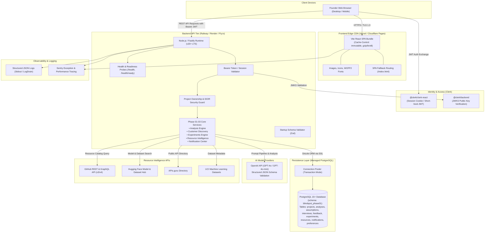

# Blindspot AI — Production Architecture Specification

## Overview

**Blindspot AI** is a multi-tier, AI-powered product validation SaaS designed for student founders and early-stage startup teams.
This document defines the production hosting topology, network boundaries, authentication handshakes, database connection topology, and external service integrations.

---

## Architecture Topology

---

## Tier Specifications

### 1. Frontend Tier
- **Framework**: React 18 with TypeScript 5 and Vite 6.
- **Routing**: `react-router-dom` v7 with lazy route chunking and branded `<RouteLoadingFallback />`.
- **Target Hosting**: **Vercel** or **Cloudflare Pages**.
  - Direct git push integration from `main` branch.
  - Zero server-side runtime; purely static immutable assets cached at global edge locations.
  - Client-side rewrites configured via `vercel.json` and `_redirects` (`/* /index.html 200`).
- **Production Asset Sizing**:
  - Initial entry chunk: `< 98 kB` gzipped.
  - Core vendor runtime: `~112 kB` gzipped.
  - Total cold load: `< 200 kB` gzipped.
- **Security Headers**:
  - `Content-Security-Policy`: Restricts scripts, styles, frames to self, Clerk domains, and Google Fonts.
  - `X-Frame-Options: DENY`
  - `X-Content-Type-Options: nosniff`
  - `Referrer-Policy: strict-origin-when-cross-origin`

### 2. Backend API Tier
- **Runtime**: Node.js v20+ LTS inside minimal Debian / Alpine Docker container.
- **Framework**: Fastify v4 / Express-compatible modular router.
- **Target Hosting**: **Railway** or **Render** Web Service.
  - Scaled horizontally with automatic restart on container exit.
  - HTTP Keep-Alive and Keep-Alive timeouts tuned for reverse proxy compatibility.
  - CORS strictly configured to allow only verified production frontend domain.
  - Rate limiting enabled via in-memory token bucket (`100 req/min/IP` baseline).
- **Graceful Shutdown**:
  - Handles `SIGTERM` and `SIGINT` signals.
  - Waits up to 10 seconds for in-flight HTTP connections and database transactions to cleanly finish before closing pool.

### 3. Database & Storage Tier
- **Engine**: Managed PostgreSQL 15+ (e.g. Neon Serverless Postgres or Supabase).
- **ORM / Query Builder**: Drizzle ORM with schema segregation under `"blindspot_phase01"`.
- **Connection Management**:
  - PgBouncer connection pooler in Transaction Mode.
  - Max pool connections: 20 per container instance.
  - `ssl: { rejectUnauthorized: true }` mandatory in production.
- **Migration Execution**:
  - Sequential numbered migrations (`0000_init.sql` to `0006_notifications_and_preferences.sql`).
  - Executed as a pre-deploy release step in CI/CD before container rollover.

### 4. Authentication Tier
- **Provider**: Clerk Auth.
- **Mechanism**:
  - Frontend: `@clerk/clerk-react` handles sign-up, sign-in, session recovery, and multi-factor authentication.
  - Backend: `@clerk/backend` verifies short-lived JWTs via asymmetric RS256 JWKS public key rotation.
  - Zero sensitive user passwords stored in Blindspot AI database.
  - User identity maps to `owner_id` (Clerk User ID) across all data models.

### 5. AI Engine Tier
- **Provider**: OpenAI API (primary) with fallback provider options.
- **Model**: `gpt-4o` for deep multidimensional analysis, `gpt-4o-mini` for feedback synthesis and interview question generation.
- **Validation**: Strict Zod output contract schemas enforce deterministic JSON structure, preventing hallucinations or truncated outputs.
- **Rate Limits & Budgets**:
  - Exponential backoff with jitter on HTTP 429/503.
  - Per-project analysis request throttle to prevent quota exhaustion.

---

## Network & Communication Protocols

| Source | Destination | Protocol | Port | Authentication |
| :--- | :--- | :--- | :--- | :--- |
| Founder Browser | Frontend CDN | HTTPS / TLS 1.3 | 443 | None (Public Static Assets) |
| Founder Browser | Backend API | HTTPS / TLS 1.3 | 443 | Clerk Bearer JWT |
| Backend API | PostgreSQL | PostgreSQL / SSL | 5432 / 6543 | Database Password + SSL Cert |
| Backend API | OpenAI API | HTTPS / TLS 1.3 | 443 | API Key (`OPENAI_API_KEY`) |
| Backend API | GitHub API | HTTPS / TLS 1.3 | 443 | Personal Access Token (`GITHUB_TOKEN`) |
| Backend API | Hugging Face Hub | HTTPS / TLS 1.3 | 443 | User Access Token (`HF_TOKEN`) |
| Backend API | Sentry | HTTPS / TLS 1.3 | 443 | DSN Token |

---

## Production Security Controls

1. **Zero Secret Leakage**:
   - Frontend bundles contain only `VITE_CLERK_PUBLISHABLE_KEY` and `VITE_API_BASE_URL`.
   - All backend secrets (`CLERK_SECRET_KEY`, `DATABASE_URL`, `OPENAI_API_KEY`, `GITHUB_TOKEN`, `HF_TOKEN`) are injected strictly at runtime via container environment variables.
2. **Tenant Isolation (IDOR Defense)**:
   - Every database query for projects, analyses, feedback, experiments, and resources includes `where: eq(projects.ownerId, authenticatedUserId)`.
   - Access attempts to resources belonging to other owners return HTTP 404 (preventing user enumeration).
3. **Input Sanitization**:
   - All inbound payloads are validated using Zod schemas with string length constraints, regex filters, and numeric bounds.
